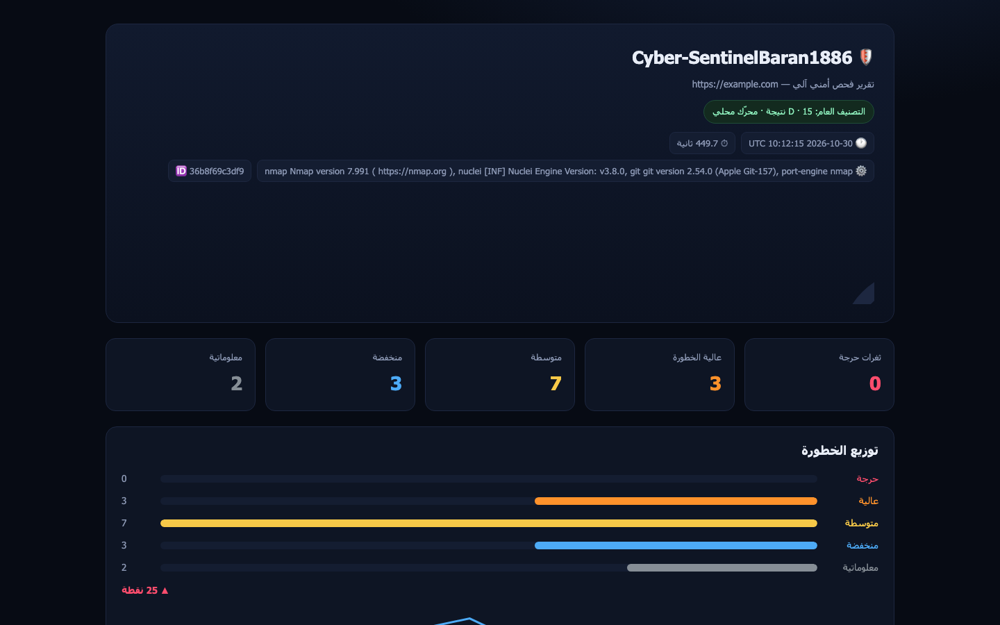
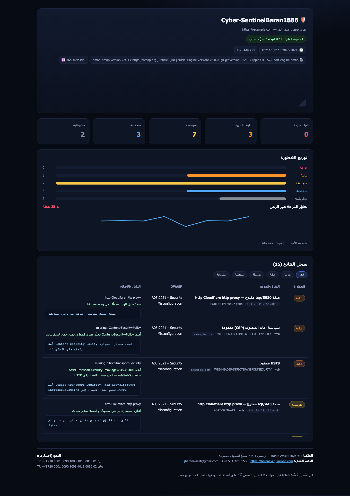
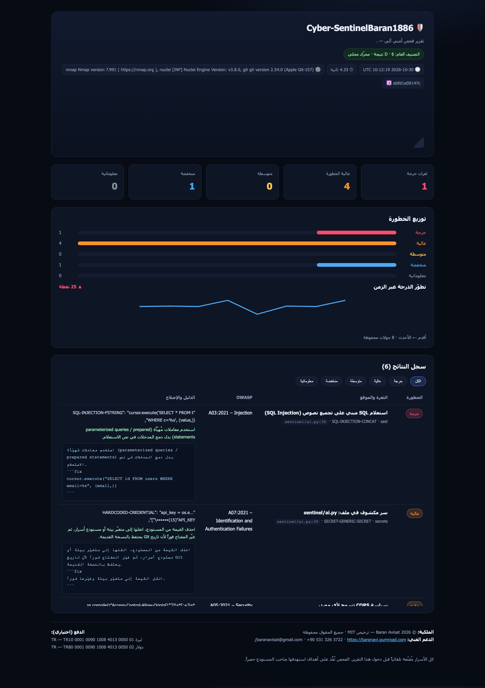

# 🛡️ Cyber-SentinelBaran1886

**منظومة الفحص الأمني، اختبار الاختراق، والحماية الذاتية اللامركزية**

> نظام ذكي متكامل للاختراق الآلي، فحص الويب ومنافذ الشبكات، واكتشاف الثغرات في
> التطبيقات والمواقع — يمشّي خوادمك ومستودعاتك دورياً، يفحص الأكواد والروابط
> بحثاً عن ثغرات OWASP Top 10 والحقن والإعدادات الخاطئة، يرسل تقريراً فورياً
> بدرجة الخطورة، ويقترح **كود الإصلاح آلياً** — دون دفع دولار واحد لأي أداة
> أمنية مدفوعة، وبموارد مجانية بالكامل.

---

## 📋 لماذا يتمنى كل شركة وكل فرد الحصول عليه؟

| الميزة | القيمة |
|---|---|
| **توفير مال فلكي** | أدوات فحص الأمان واختبار الاختراق تكلف الشركات ثروات سنوياً؛ هذا النظام يؤدي نفسه بتكلفة **صفر**. |
| **الحماية الاستباقية الفورية** | يكتشف الثغرات قبل أن يستغلها المخترقون، فيمنع الاختراقات وتسريب البيانات المدمّرة. |
| **السيادة والخصوصية التامة** | الفحص يتم محلياً وبأدوات مفتوحة المصدر — لا تُرسل أكوادك أو بياناتك إلى جهة خارجية. |
| **إصلاح لا مجرد إبلاغ** | كل ثغرة تأتي مع الكود الآمن البديل جاهزاً للنسخ بفضل طبقة الذكاء الاصطناعي. |

---

## 🛠️ الموارد المجانية البحتة (The Free Tech Stack)

| المكون الأساسي | الخدمة / التقنية المجانية | دورها في المشروع |
|---|---|---|
| محرك التشغيل والمراقبة المجدولة (Cron) | **GitHub Actions** | تنفيذ الفحص الأمني دورياً مع كل تحديث أو على جدول زمني. |
| محرك الفحص الساكن والديناميكي | **Python + Semgrep + Nuclei + Nmap** | أدوات مفتوحة المصدر لفحص الأكواد والمنافذ واكتشاف الثغرات. |
| محرك التحليل وتوليد الحلول (AI Brain) | **Google Gemini / Groq / OpenRouter / Ollama** (Free Tiers) | تقييم خطورة الثغرة وكتابة كود الإصلاح الآمن. |
| قاعدة البيانات والتخزين | **Supabase (PostgreSQL Free Tier)** | حفظ سجلات الفحص وحالة الثغرات عبر الزمن. |
| قناة التقارير والتنبيهات الفورية | **Telegram Bot + تقرير HTML** | إنذار فوري على هاتفك مع التفاصيل والإصلاح. |

لا يحتاج المشروع إلى أي مفتاح مدفوع: **يُشغَّل بملء الأنفاس بصفر إعداد** (محرّك محلي + تقارير ملفية)، ويرتقى تدريجياً كلما أضفت مفاتيح المجانية.

---

## 📐 البنية البرمجية (Software Architecture)

```
[ مستودع الكود أو الخوادم المستهدفة بالفحص ]
                │
                ▼
[ GitHub Actions + أدوات الفحص المفتوحة (Semgrep / Nuclei / Nmap) ]
                │
                ▼
[ Google Gemini / Groq (تحليل تقرير الثغرات وتوليد كود الإصلاح المقترح) ]
                │
                ▼
[ تخزين التقرير في Supabase ──► إرسال إنذار أمني عاجل مع الحل إلى تليجرام ]
```

### الطبقات الأربع برمجياً

**1️⃣ طبقة الفحص والمسح الأمني** (`sentinel/sast.py`, `secrets_scan.py`, `web.py`, `ports.py`)
محرك قواعد مدمج (18 قاعدة OWASP) يعمل بلا أي تبعيات، بالإضافة إلى تمريرة
اختيارية عبر `semgrep` و`nuclei` و`nmap` متى وُجدت على النظام. يبحث في كل سطر
عن حقن SQL/XSS، تنفيذ أوامر، تعطيل TLS، مفاتيح مكشوفة، إعدادات خاطئة،
ضعف عشوائية، وغيرها.

**2️⃣ العقل الذكي وتقييم المخاطر** (`sentinel/ai.py`)
يأخذ النتائج الخام، يحدّد خطورتها بدقة (وCVSS)، ثم **يكتب الكود الآمن البديل**.
يعمل مع Gemini 1.5 Flash أو Groq Llama 3.3 أو OpenRouter أو Ollama محلي،
وإذا لم يوجد مفتاح فإن **كتاب القواعد المدمج** يكفي ليُصدر تقريراً كاملاً.

**3️⃣ طبقة الأرشيف والتاريخ** (`sentinel/store.py` + `supabase/schema.sql`)
حفظ كل جولة في Supabase وفي `reports/*.json` محلياً، مع منحنى يقارن الدرجة
الحالية بالجولات السابقة للتأكد من خلو المشروع دوماً من التهديدات.

**4️⃣ طبقة التوصيل الفوري** (`sentinel/alert.py`, `report.py`)

> 🚨 إنذار أمني حرج: تم اكتشاف ثغرة حقن بيانات في الملف `auth.py`.
> 🛠️ الإصلاح المقترح: (الكود الآمن البديل جاهز للنسخ والإصلاح)…

---

## ⚙️ التشغيل السريع

```bash
# 1) المتطلبات: بايثون 3.9+ فقط (كل شيء اختياري)
git clone https://github.com/aoodiakdiro0001-ops/cyber-sentinelbaran1886.git
cd cyber-sentinelbaran1886

# 2) تشخيص البيئة والقنوات
python3 -m sentinel doctor

# 3) فحص موقع
python3 -m sentinel scan --target https://example.com

# 4) فحص كودك المحلي (سكوني + أسرار)
python3 -m sentinel scan --target . --mode source

# 5) فحص منافذ مضيف
python3 -m sentinel scan --target scanme.nmap.org --mode ports
```

التقارير تُكتب إلى `reports/`:

- `report.html` — لوحة عربية تفاعلية تُفتح في المتصفح وتعمل دون إنترنت
- `report.json` — نفس البيانات للتكامل مع أدواتك
- `latest.json` + طوابع زمنية — سجل الجولات

### إعداد المفاتيح (اختياري، كلها مجانية)

```bash
cp .env.example .env      # ثم ضع القيم
python3 -m sentinel doctor # تأكد من الربط
```

| الخدمة | متغيّر البيئة | أين تحصل عليه مجاناً |
|---|---|---|
| Google Gemini | `GEMINI_API_KEY` | https://aistudio.google.com/apikey |
| Groq | `GROQ_API_KEY` | https://console.groq.com/keys |
| OpenRouter | `OPENROUTER_API_KEY` | https://openrouter.ai/keys |
| Ollama محلي | `OLLAMA_URL` | `ollama serve` (بلا إنترنت) |
| Supabase | `SUPABASE_URL` + `SUPABASE_SERVICE_ROLE_KEY` | https://supabase.com ثم شغّل `supabase/schema.sql` |
| Telegram | `TELEGRAM_BOT_TOKEN` + `TELEGRAM_CHAT_ID` | `@BotFather` |

> ملف `.env` محجوب بـ `.gitignore` ولن يُرفع أبداً. **لا تضع مفاتيحك في الكود.**

### إعداد الـ Secrets في GitHub

`Settings → Secrets and variables → Actions` ثم أضف:
`GEMINI_API_KEY` · `GROQ_API_KEY` · `SUPABASE_URL` · `SUPABASE_SERVICE_ROLE_KEY` ·
`TELEGRAM_BOT_TOKEN` · `TELEGRAM_CHAT_ID`

### إطلاق فحص يدوي

`Actions → 🛡️ Security Scan → Run workflow` واكتب الهدف، أو انتظر الجدولة
اليومية (`03:17 UTC`). عند وجود ثغرة حرجة تُفتح Issue تلقائياً وتُرفع نسخة
`report.html` كـ artifact لمدة 30 يوماً.

الهدف الافتراضي للـ CI هو **مصدر المستودع ذاته**؛ اكتب رابطاً يدوياً في
حقل الهدف لفحص موقع أو خادم آخر.

### استثناءات فحص الذات (`.sentinelignore`)

سطر واحد للنمط و`#` للتعليق، ويقرأها المحرّك تلقائياً من جذر الفحص:

```gitignore
# نمط glob أو مقطع مسار حرفي
*.pem
migrations/
sentinel/sast.py
```

مستخدَم هنا لاستثناء ملفات تعريف القواعد وأمثلة الإصلاح ذاتها — المحرّك
لا يكتشف قواعدها على نفسها — بينما تبقى بقية الملفات تحت الفحص الكامل.

---

## 📸 لقطات من التقرير الحي

التقرير ملف HTML واحد يعمل بلا إنترنت (بلا CDN وبلا تتبّع) — هذه لقطات من فحوصات حقيقية نُفِّذت بالمحرّك المحلي **بلا أي مفتاح API**:

**١) نظرة عامة — فحص `https://example.com` (15 نتيجة · D):**



**٢) سجل النتائج كاملاً مع الدليل ومقترح الإصلاح:**



**٣) تقرير فحص الكود المصدري (SAST + كشف الأسرار):**



---

## 📁 هيكل المشروع

```
cyber-sentinelbaran1886/
├── sentinel/                  # نواة النظام (بايثون نقي بلا تبعيات إلزامية)
│   ├── cli.py                 # scan · report · history · doctor · init
│   ├── sast.py                # محرك القواعد الساكنة + Semgrep
│   ├── secrets_scan.py        # كشف الأسرار المكشوفة (مع قنّع إلزامي)
│   ├── web.py                 # ترويسات الأمان · TLS · الكوكيز · الروابط المكسورة
│   ├── ports.py               # Nmap أو مسح مافات احتياطي (socket)
│   ├── ai.py                  # Gemini/Groq/OpenRouter/Ollama + كتاب القواعد المحلي
│   ├── store.py               # Supabase + سجل JSON محلي
│   ├── alert.py               # إنذار تليجرام
│   ├── report.py              # توليد لوحة HTML عربية تفاعلية
│   ├── redact.py              # إخفاء الأسرار قبل أي إخراج
│   └── models.py              # نموذج الثغرة + حساب الدرجة والتصنيف
├── .github/workflows/security-scan.yml   # الجدولة + الفحص اليدوي + فتح Issue
├── supabase/schema.sql        # مخطط قاعدة البيانات (شغّله مرة واحدة)
├── targets.example.txt        # نموذج أهداف الفحص
├── .sentinelignore            # استثناءات فحص الذات (ملفات تعريف القواعد)
├── .env.example               # كل المفاتيح المطلوبة موثّقة
├── SUPPORT.md                 # الدعم وحقوق الملكية وطرق الدفع
└── LICENSE                    # MIT © 2026 Baran Avisat
```

---

## 🚀 المزايا الرئيسية

- ✅ **18 قاعدة SAST** محاذاة لـ OWASP Top 10 (2021) + دعم Semgrep
- ✅ **كشف الأسرار** (GitHub/AWS/OpenAI/Slack/الخاصيات… ) مع **قنّع إلزامي** — لا سر يخرج في تقرير
- ✅ **تدقيق الويب**: HSTS · CSP · X-Frame · Cookies · TLS 1.3 · كشف إصدارات الخادم · روابط مكسورة
- ✅ **فحص المنافذ** مع تفسير كل منفذ حساس (Redis/Mongo/Docker/RDP…) وخطوته
- ✅ **طبقة ذكاء اصطناعي** تُنتج درجة CVSS و**كود إصلاح جاهزاً** بالعربية
- ✅ **تنبيه تليجرام فوري** للثغرات الحرجة
- ✅ **لوحة HTML عربية** تفاعلية بفلاتر خطورة ومنحنى تطور الزمن — بلا CDN
- ✅ **GitHub Actions**: جدولة يومية + فحص عند كل Push + فتح Issue تلقائي
- ✅ **يعمل بصفر إعداد**: لا مفاتيح؟ محرّك محلي كامل والتقارير ملفات

---

## 📞 الدعم والمساهمة

- **البريد:** baranavisat@gmail.com
- **الهاتف / واتساب:** +90 531 326 3722
- **المتجر الرسمي:** https://baranavi.gumroad.com/
- التفاصيل الكاملة وطرق الدفع في [SUPPORT.md](SUPPORT.md)

## 📜 الترخيص

MIT License — © 2026 **Baran Avisat**. جميع الحقوق محفوظة.

> استخدم النظام فقط على أصول تملكها أو تملك إذناً كتابياً بفحصها. الفحص الذاتي
> لا يُغني عن تقييم أمني بشري معتمد قبل الإطلاق للإنتاج.
